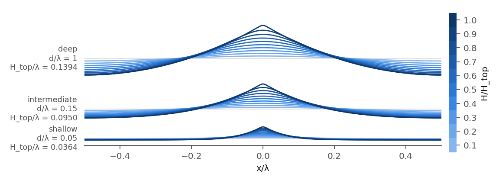
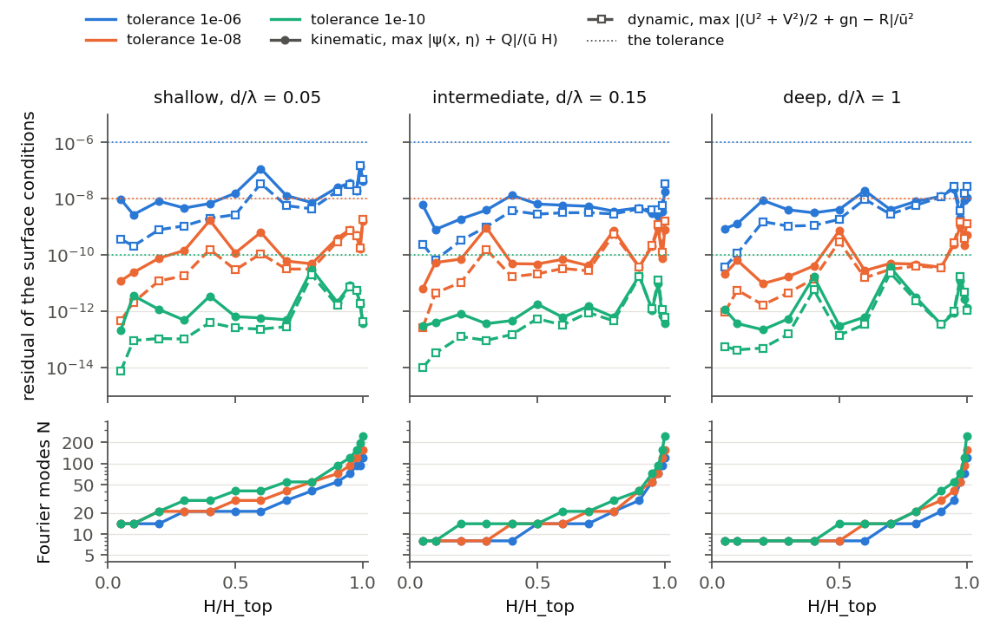

<!--
  Copyright (C) 2012-2017 DHI A/S
  Copyright (C) 2017-2026 Johan Roenby
  SPDX-License-Identifier: GPL-3.0-or-later
-->

# streamFunctionWave

Developed and maintained by Johan Roenby, [STROMNING](https://stromning.com).

Steady nonlinear water waves of any height up to near breaking, on any depth,
for OpenFOAM.com: a wave generating boundary condition, a utility that sets the
fields of a case to the exact wave at every time step, and a utility that
calculates the wave. The waves are stream function waves, calculated with the
Fourier approximation method of section 3.1.2 of

> Fenton, J. D. (1999). Numerical methods for nonlinear waves. *Advances in
> Coastal and Ocean Engineering*, 5, 241–324.

whose equation numbers the code refers to. The method assumes two-dimensional,
inviscid and irrotational flow over a horizontal bed, in a frame in which the
wave is steady, but no small wave height, unlike linear (Airy) or Stokes
waves.

streamFunctionWave is the successor of
[fentonWave](https://github.com/roenby/fentonWave), developed at DHI; see
[History](#history).

## Contents

| Directory | What |
|---|---|
| [src/streamFunctionWave](src/streamFunctionWave) | The class `streamFunctionWave`: calculates the wave and gives the surface elevation, velocity and pressure at any point and time |
| [src/streamFunctionWaveFvPatchField](src/streamFunctionWaveFvPatchField) | The boundary condition `streamFunctionWave` for the volume fraction and the velocity, in the library `libstreamFunctionWaveFvPatchField` |
| [applications/streamFunFoam](applications/streamFunFoam) | Sets `alpha`, `U`, `phi`, `p` and `p_rgh` of an interFoam-type case to the wave at every time step: initial conditions, or a reference solution sampled as a simulation would be |
| [applications/calcStreamFunctionWave](applications/calcStreamFunctionWave) | Calculates a wave from an input dictionary and writes its parameters and Fourier coefficients |
| [applications/generateStreamFunctionWaveTable](applications/generateStreamFunctionWaveTable) | Generates the table of precomputed waves that a wave is started from |
| [src/streamFunctionWave/table](src/streamFunctionWave/table) | The table, compiled into the library |
| [run](run) | Example cases |
| [test](test) | Tests |
| [doc](doc) | The figures of this README, made by the tests |

## Installation

With OpenFOAM.com sourced (v2306 to v2606):

```sh
git clone https://github.com/isoAdvector/streamFunctionWave.git
cd streamFunctionWave
./Allwmake
```

This builds `libstreamFunctionWaveFvPatchField` into `$FOAM_USER_LIBBIN` and
`streamFunFoam`, `calcStreamFunctionWave` and `generateStreamFunctionWaveTable`
into `$FOAM_USER_APPBIN`. Build it again with each OpenFOAM version used.

## Usage

### The wave

The wave is described in a dictionary, by default `constant/waveProperties`
(see [applications/calcStreamFunctionWave/waveProperties](applications/calcStreamFunctionWave/waveProperties)):

| Entry | Meaning | Default |
|---|---|---|
| `H` | wave height (crest to trough) | required |
| `d` | mean water depth | required |
| `uType` | what gives the length: `0` wave length `lambda`, the wave seen in its own frame; `1` period `T` and Eulerian mean current `u`; `2` period `T` and mass transport velocity `u`; `3` wave length `lambda` and period `T` | `2` |
| `T` | wave period (`uType` 1, 2, 3) | |
| `lambda` | wave length (`uType` 0, 3) | |
| `u` | current (`uType` 1, 2) | `0` |
| `tolerance` | largest error of the surface elevation (relative to `H`) and of the velocities (relative to the mean fluid speed in the frame of the wave) | `1e-8` |
| `g` | gravity | `9.81` |
| `direction` | direction of propagation (boundary condition, `streamFunFoam`) | required |
| `seabedHeight` | vertical position of the bed | lowest point of the patch or mesh |
| `waveMakerPos` | origin of the horizontal coordinate | first point of the patch or mesh along `direction` |
| `phase` | phase, in wave lengths | the surface at the mean level at the origin at time 0 |

`streamFunFoam` also reads `uAir` (velocity of the air, default zero) and
`comoving` and `c` (to give the water velocity in a frame moving with
celerity `c`).

The number of Fourier modes follows from `tolerance`; the entries `N` and
`nHSteps` of earlier versions are ignored with a warning. The log gives the
number of modes, the estimated error and the time, typically a few
milliseconds.

**Range.** Waves are calculated for relative depths d/λ from 0.03 to 3 (deeper
water is calculated as at d/λ = 3, where tanh(kd) = 1 to machine precision)
and heights up to H_top(d/λ), the highest wave of the table. H_top is 98.8 %
of the limiting height in deep water (H/λ = 0.1394 against 0.1411), 97 % at
d/λ = 0.1 and 92 % at d/λ = 0.03, against Fenton's (1990) fit of the limiting
height. A higher wave is an error, which gives H_top; a shallower wave is
tried with a warning and may be slow or fail. If the wave length follows from
the period and an opposing current, a much shorter wave may have the same
period; the longest is calculated and the other noted in the log. Within
about 2 % of H_top the prescribed height determines the wave only to about
1e-9, so a smaller tolerance there gives a warning and the best attainable
wave.

### The boundary condition

In `0/U` and `0/alpha.water` (the patch also works for `alpha1`):

```
inlet
{
    type            streamFunctionWave;
    value           uniform (0 0 0);    // uniform 0 for alpha.water
    waveDictName    waveProperties;     // default: waveProperties
    waveDictPath    "constant";         // default: "constant"
}
```

and in `system/controlDict`:

```
libs            (streamFunctionWaveFvPatchField);
```

A `fixedFluxPressure` condition suits `p_rgh` on the patch. The wave is
calculated from the wave dictionary whenever the patch is constructed, at the
start of a run, at a restart and when a utility reads the fields, so a changed
dictionary takes effect at the next restart. The mesh holds the wave of each
patch, so its fields share one calculation, and so do the fields that
`foamToVTK`, `sample` or `postProcess` read at the different times;
`reconstructPar` calculates it once per processor. The patch writes the main
results of the wave (length, number of modes, estimated error, H/H_top) to a
`wave` sub-dictionary of its entry, for information only.

### streamFunFoam and calcStreamFunctionWave

`streamFunFoam`, run in a case like a solver, writes the wave fields at every
write time; its time step follows `maxCo`, `maxAlphaCo` and `maxDeltaT` as in
the VoF solvers. With `endTime 0` it writes the initial fields of a
simulation. `calcStreamFunctionWave <inputDict> <outputDict>` writes the wave
length, celerity, currents, crest and trough heights and the Fourier
coefficients of a wave.

### Example cases

| Case | What |
|---|---|
| [run/waveFlume](run/waveFlume) | A flume with the boundary condition at the inlet, run with `interIsoFoam` |
| [run/streamFunWaveFlume](run/streamFunWaveFlume) | The same flume with the fields set by `streamFunFoam` |
| [run/periodicWaveTank](run/periodicWaveTank) | A periodic tank of one wave length, initialised by `streamFunFoam` and run with `interIsoFoam` |

Each case has an `Allrun` and an `Allclean`. The wave is that of H = 0.24 m
and T = 1.8 s on 1 m of water, for 30 s.

## How the wave is calculated

### The wave problem

In the frame moving with the wave the flow is steady. With x along the wave,
y up from the bed and k = 2π/λ, Fenton writes the stream function as

$$\psi(x, y) = -\bar{u}\,y + \sqrt{g/k^3}\,\sum_{j=1}^{N} B_j\,\frac{\sinh jky}{\cosh jkd}\cos jkx,$$

where ū is the mean fluid speed in this frame. Every term satisfies the
Laplace equation and the condition of no flow through the bed (ψ = 0 at y =
0) exactly. The coefficients B_j, ū and the surface η(x) have to satisfy the
two conditions at the surface,

- **kinematic**: the surface is a streamline, ψ(x, η) = −Q, with Q the volume
  flux under the wave in this frame;
- **dynamic**: the pressure at the surface is constant, so by Bernoulli
  (U² + V²)/2 + gη = R, with U, V the velocity in this frame and R a
  constant;

together with the mean depth d, the height H, and for period input
(`uType` 1, 2) the relation between the period, the current and the wave
length. Fenton (1999) collocates the surface conditions at N + 1 points over
half a wave length, which with these conditions gives as many equations as
unknowns, and solves them by Newton's method, stepping the height up from a
linear wave.

### What is different here

The square system of Fenton's method fixes the high coefficients B_j only to
round-off in absolute terms, and the series amplifies that error near the
crest of a steep wave by about exp(jk(η_crest − d)). For steep waves more
modes then make the wave worse, and the user had to find a number of modes
`N` and of height steps `nHSteps` that worked. This implementation instead:

1. **Solves in the least-squares sense.** The surface conditions are
   collocated at M = 2N points over half a wave length, so there are more
   equations than unknowns. The equations are solved by Gauss-Newton
   iteration. In each iteration the surface elevations at the points are
   eliminated exactly by orthogonal transformations, as each appears only in
   the conditions at its own point, and the remaining problem in B_j, ū, Q
   and R (and k for period input) is solved by a QR decomposition with column
   pivoting, truncated where the pivots fall below 1e-13 of the first, and of
   least norm. More modes then no longer spoil the solution, and the surface
   conditions are satisfied to round-off also for steep waves.
2. **Measures the error by self-convergence.** The wave is calculated with N
   modes and again with about 25 % more, and accepted when the two agree to
   half the tolerance in the surface elevation relative to H, the velocities
   at the surface relative to ū, and ū, Q, R and k. The one with fewer modes is
   used. The residual of the equations is not a safe measure: near the highest
   wave it can be small while the wave is still far from converged.
3. **Starts from a table of precomputed waves.** For 21 relative depths d/λ
   from 0.03 to 3 (logarithmically spaced) the table holds 16 waves with
   heights H/H_top from 0.12 to 1, closer together towards the top. Each holds
   its surface, ū, Q and R with the fewest modes that give 1e-10, and the
   number of modes needed for each tolerance from 1e-4 to 1e-12. A request
   interpolates these (cubic in log d/λ and in height) to a first guess and its
   number of modes, fits B_j to the guessed surface, and converges in a few
   iterations. No stepping in height is needed.
4. **Knows the highest wave it can calculate.** The table ends at H_top, found
   for each depth by continuation in the crest parameter ω = 1 − U_crest²/U_trough²
   (which is 1 for the limiting wave with its stagnant, sharp crest) with up to
   197 modes at a tolerance of 1e-10. The modes needed grow as 1/(1 − ω), and
   faster in shallow water, so H_top is closer to the limiting height in deep
   water (98.8 %) than in shallow water (92 % at d/λ = 0.03). A higher wave is
   an error instead of an unconverged result.
5. **Finds the wave length for period input from the table.** The wave length
   that gives the requested period and current is found by root finding over
   the table's waves, so the calculation starts at the right wave length and
   solves for it together with the rest.

Near H_top the height changes little with the shape of the wave, so a wave of
given height is determined only to about 1e-9 within 2 % of H_top. The error
estimate includes this, and a smaller tolerance there gives a warning and the
best attainable wave.

The figure shows waves calculated this way from 0.1 to 1 times H_top at three
depths. The surfaces are drawn in units of the wave length with the same scale
on both axes, each depth about its own mean water level (grey).



The table ([src/streamFunctionWave/table](src/streamFunctionWave/table), 1
MB of text) is written by `generateStreamFunctionWaveTable` in about 6
minutes and compiled into the library as constant data. It takes 0.4 MB of
the library, is shared between the processes on a node, and only the few
nodes around a requested wave are read. Regenerate it, and rebuild the
library, only to change its range or resolution (see the description in its
source).

### Accuracy

Since the field equation and the bed condition hold exactly, the accuracy of
a wave is how well it satisfies the two surface conditions. The figure gives
their largest residuals at 4001 points over half a wave length, mostly
between the points where the equations were solved, for waves from 0.05 to 1
times H_top at the three depths of the figure above and for three
tolerances. The residuals are evaluated by
[test/figures.py](test/figures.py) from the Fourier coefficients written by
`calcStreamFunctionWave`, independently of the C++ code, and scaled to compare
with the tolerance: the kinematic residual by ūH, which gives about the
displacement of the surface relative to H, and the dynamic one by ū², which
gives about the error of the speed at the surface relative to ū. The lower
panels give the number of modes used.



The residuals lie 1 to 3 orders of magnitude below the tolerance, and fall
with it, also at H_top. The tolerance bounds the difference to the exact wave,
which the residual underestimates near the top, as noted above.

## Tests

With OpenFOAM sourced and streamFunctionWave built, `test/Allrun` (a few
minutes, mostly the example cases) checks:

- **[test/fourier/fenton.py](test/fourier/fenton.py)**, an independent
  implementation of Fenton's method in Python (numpy, scipy), against the
  linear dispersion relation for small waves and against the celerity of
  Stokes waves in deep water.
- **`calcStreamFunctionWave` against fenton.py**
  ([test/fourier/compare.py](test/fourier/compare.py)) for each `uType`, from
  shallow water (kd = 0.28) to deep water (kd = 31), up to H/λ = 0.1. The wave
  numbers, celerities, currents, volume fluxes, Bernoulli constants and crest
  and trough heights agree to 1e-10 relative or better for moderate waves,
  and to 1e-8 at H/λ = 0.1 in deep water, where the difference Jacobian of
  fenton.py limits the agreement.
- **Random requests**
  ([test/requests](test/requests)): 60 waves over the range of the table, all
  input types and tolerances from 1e-6 to 1e-10, each against the same wave
  calculated to a 1000 times smaller tolerance (the surface elevation, the
  velocities at the surface and the wave length, which for period input is
  that of the wave the period was taken from).
- **Accuracy and figures** ([test/figures.py](test/figures.py)): 126 waves
  at three depths, heights from 0.05 to 1 times H_top and tolerances 1e-6 to
  1e-10 satisfy the surface conditions to their tolerance (3e-9 within 2 % of
  H_top), evaluated independently of the C++ code; and the two figures of
  this README, which are written to [doc](doc).
- **The example cases** in [run](run) run for 0.2 s.
- **Binary fields**: waveFlume written in binary and restarted.
- **Parallel**: waveFlume decomposed, run on 2 cores, reconstructed and
  converted to VTK. The fields equal those of the serial run, and
  `decomposePar`, the solver, `reconstructPar` and `foamToVTK` calculate the
  wave once per mesh.

`test/Allclean` removes the work directory.

## History

Johan Roenby wrote **fentonWave**
([github.com/roenby/fentonWave](https://github.com/roenby/fentonWave)), a stream
function wave boundary condition for interFoam, at **DHI Water & Environment**
in 2012 and released it as free software. Its successor, streamFunctionWave,
was developed at DHI from 2014 to 2017: the wave calculation moved into a class
of its own without the dependency on GSL, with the currents and wave length
input of Fenton's method, the coefficients of a patch were calculated once and
shared between its fields, and `calcStreamFunctionWave` and `streamFunFoam`
were added. We gratefully acknowledge DHI, where the code was first developed.

Since 2017 Johan Roenby has developed it further: ports to the current OpenFOAM.com
releases, the wave stored in the boundary condition for restarts and parallel
runs, the input of both wave length and period (`uType` 3), `streamFunFoam`
setting the fields at every time step, and in this release a more robust
calculation (steep waves, and deep water, where it overflowed for kd > 20) and
the tests. The least-squares solution started from a table of precomputed
waves, with the number of Fourier modes set by a tolerance, followed in 2026;
with it the wave is fast enough to be recalculated whenever the patch is
constructed, so it is no longer stored in the boundary condition.
streamFunctionWave generates the waves of the test cases of
[surfacePosition](https://github.com/isoAdvector/surfacePosition) and of
fluxinator, a VoF solver to be released shortly.

## License

Copyright (C) 2012-2017 DHI A/S, Copyright (C) 2017-2026 Johan Roenby.
streamFunctionWave is an extension of OpenFOAM and, like OpenFOAM, free
software: you can redistribute it and/or modify it under the terms of the GNU
General Public License as published by the Free Software Foundation, either
version 3 of the License, or (at your option) any later version. It is
distributed in the hope that it will be useful, but without any warranty; see
[LICENSE](LICENSE) for details.

## Author

Johan Roenby, [STROMNING](https://stromning.com). STROMNING offers consulting,
custom development, training and support for interfacial and multiphase flow
simulation with OpenFOAM. Bug reports and questions are welcome as GitHub issues;
for anything else, contact johan@stromning.com.
